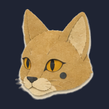
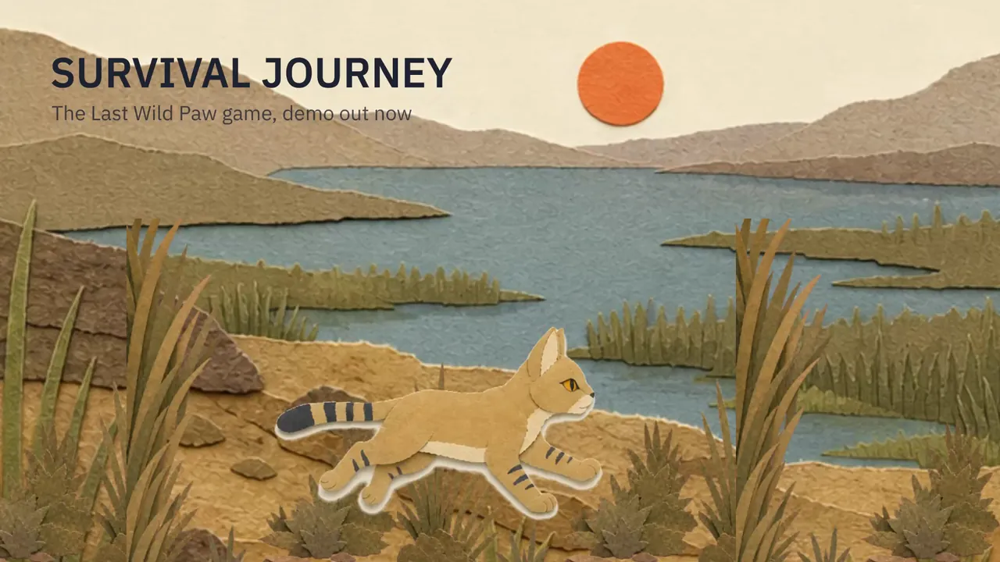
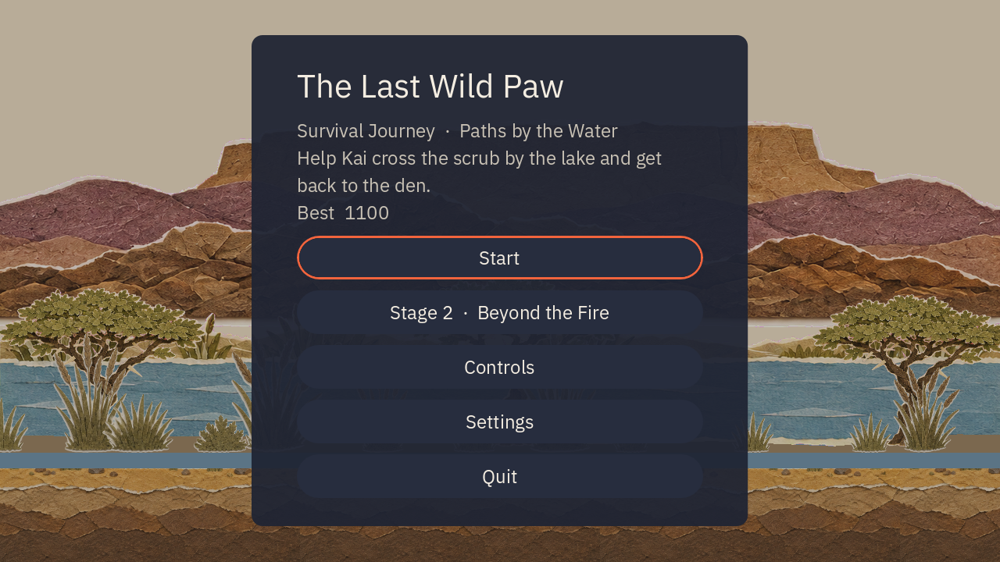
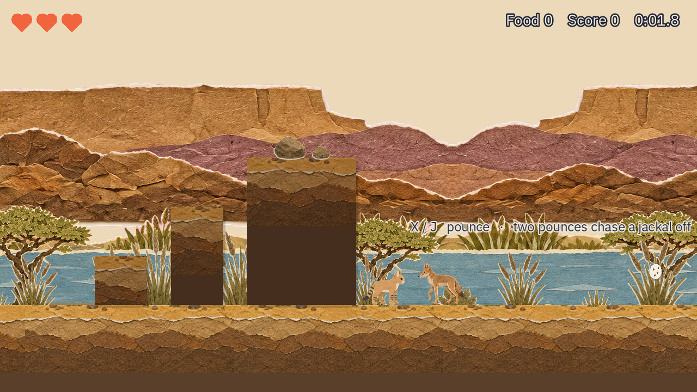
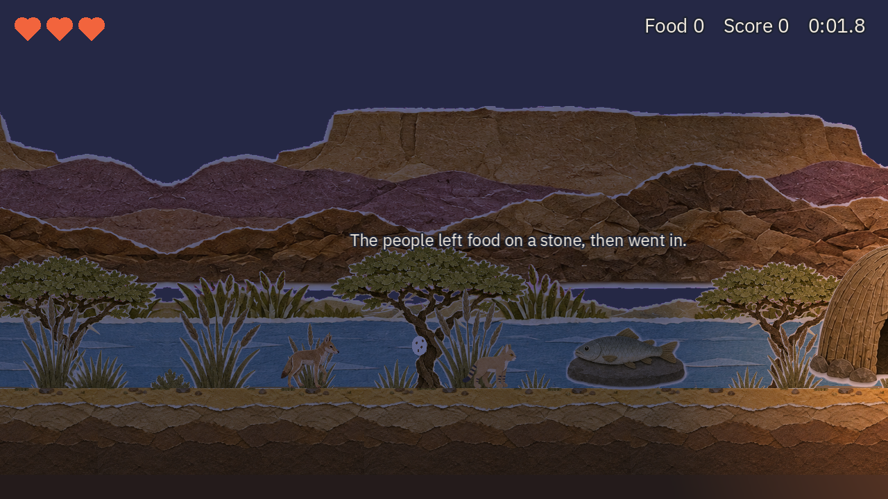

#  The Last Wild Paw: Survival Journey



A short 2D side-scroller from the animated series *The Last Wild Paw* (อุ้งเท้าป่าสุดท้าย). You play Kai, a young
African wildcat on the prehistoric Fayum lakeshore (~4500 BCE): run, jump, pounce, find food and reach the den.

**Status:** v0.1.1 release, one stage ("Paths by the Water"). The browser demo also has Stage 2 ("Beyond the Fire") and touch controls. Website: https://gomin2013.github.io/the-last-wild-paw/

**Play:** [in the browser](https://gomin2013.github.io/the-last-wild-paw/play/) · [download for macOS, Windows, Linux](https://github.com/gomin2013/the-last-wild-paw/releases/latest) ·
[leave play-test feedback](https://github.com/gomin2013/the-last-wild-paw/issues/new?template=playtest.yml)

| Title | Stage 1: Paths by the Water | Stage 2: Beyond the Fire |
|---|---|---|
|  |  |  |

## Controls

| Action | Keyboard | Gamepad |
|---|---|---|
| Run | ← → or A D | D-pad / left stick |
| Jump (hold for higher) | Z or Space | A / Cross |
| Pounce | X or J | X / Square |
| Pause | Esc | Start |

On a phone or tablet (hold it sideways), on-screen buttons appear: left / right on the left thumb, pounce (claw) and
jump (big triangle) on the right, pause at the top.

## Run from source

Requires [Godot 4.7.2](https://godotengine.org/download) (standard build, GDScript only).

```bash
godot -e --path .        # open in the editor
godot --path .           # play
```

## Checks

CI (`.github/workflows/ci.yml`) runs `gdformat` / `gdlint`, a headless import and the GUT tests in `tests/`:

```bash
godot --headless --import
godot --headless -s addons/gut/gut_cmdln.gd -gdir=res://tests -gexit
```

## Install

- **macOS:** unzip, then right-click the app › Open the first time (the build is unsigned).
- **Windows:** unzip and run `the-last-wild-paw-windows.exe`; if SmartScreen warns, choose More info › Run anyway.
- **Linux (x86_64):** unzip and run `./the-last-wild-paw-linux`.

## Build

Needs the 4.7.2 export templates. Desktop zips go to `builds/` (not committed); the Web build goes to `docs/play/`
(committed, served by GitHub Pages):

```bash
for p in macOS Windows Linux; do godot --headless --export-release "$p"; done
godot --headless --export-release "Web"
```

## Layout

| Folder | Contents |
|---|---|
| `actors/` | Kai, the jackal, props (one scene + script each) |
| `scenes/` | `main.tscn`, the stage |
| `systems/` | `GameState` autoload, pure rules (`rules/combat.gd`, `rules/score.gd`) |
| `ui/` | title, HUD, pause, result screens |
| `tests/` | GUT tests |
| `docs/` | GitHub Pages site (ignored by Godot) |

## Principles

Offline and private: no accounts, network calls or analytics; saves stay in `user://`. No Web3. Original work only:
Kunio-kun and Contra are gameplay references, nothing is copied. Playable without watching the series.

## Credits

See [CREDITS.md](CREDITS.md). © 2026 Gomin Studio.
